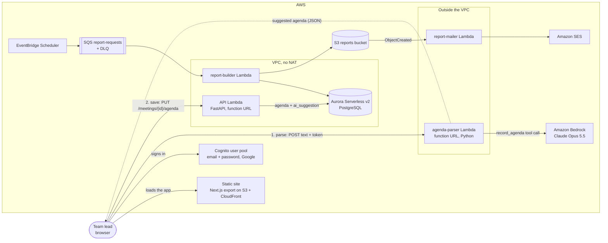

# Spry: container diagram (C4, level 2)

Updated for Lab 6: the agenda parser and Bedrock, with the two paths, **parse** and **save**.

The parser only suggests. The only path that writes is **save**, through the API that already validates
and scopes every meeting to its owner.
